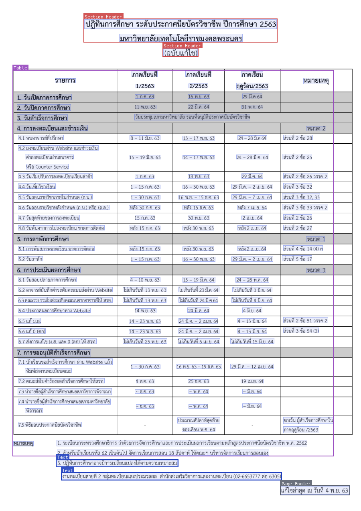
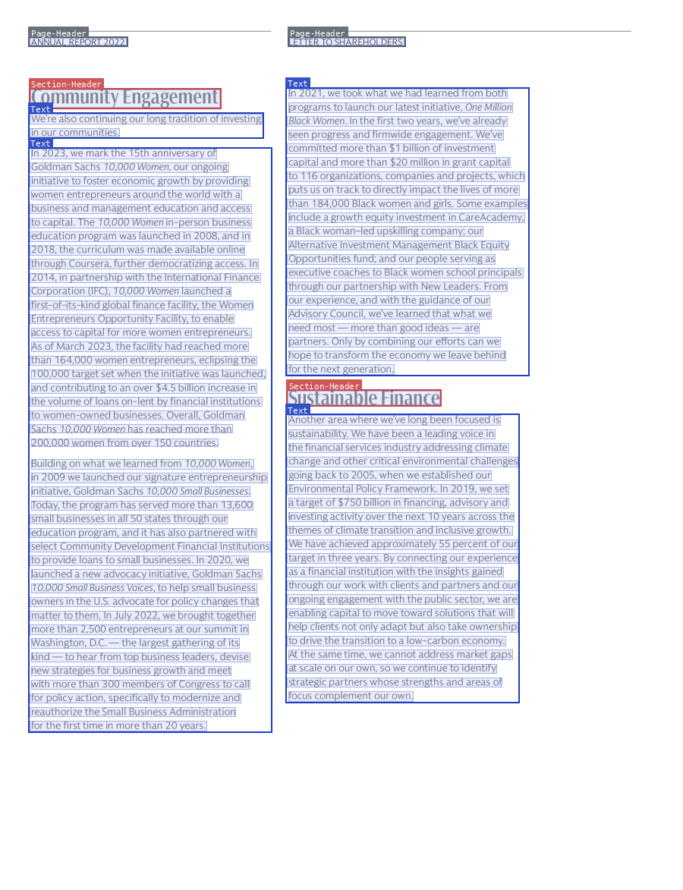
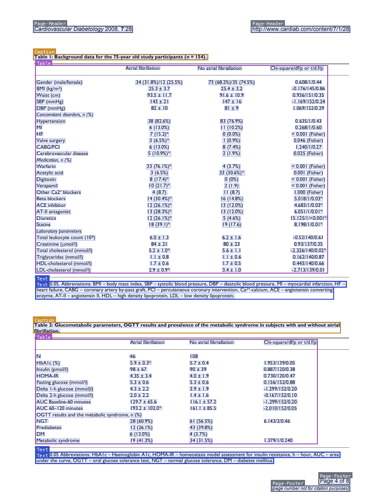
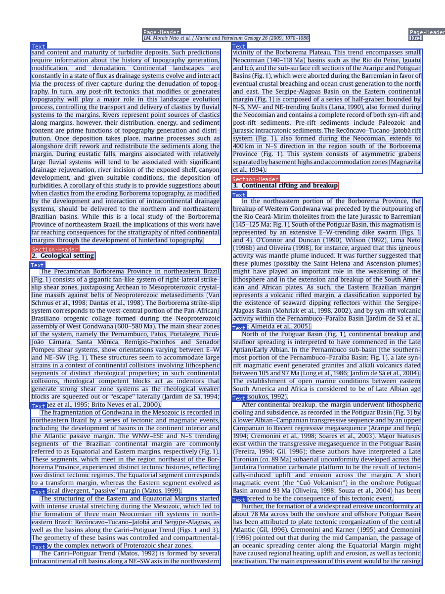
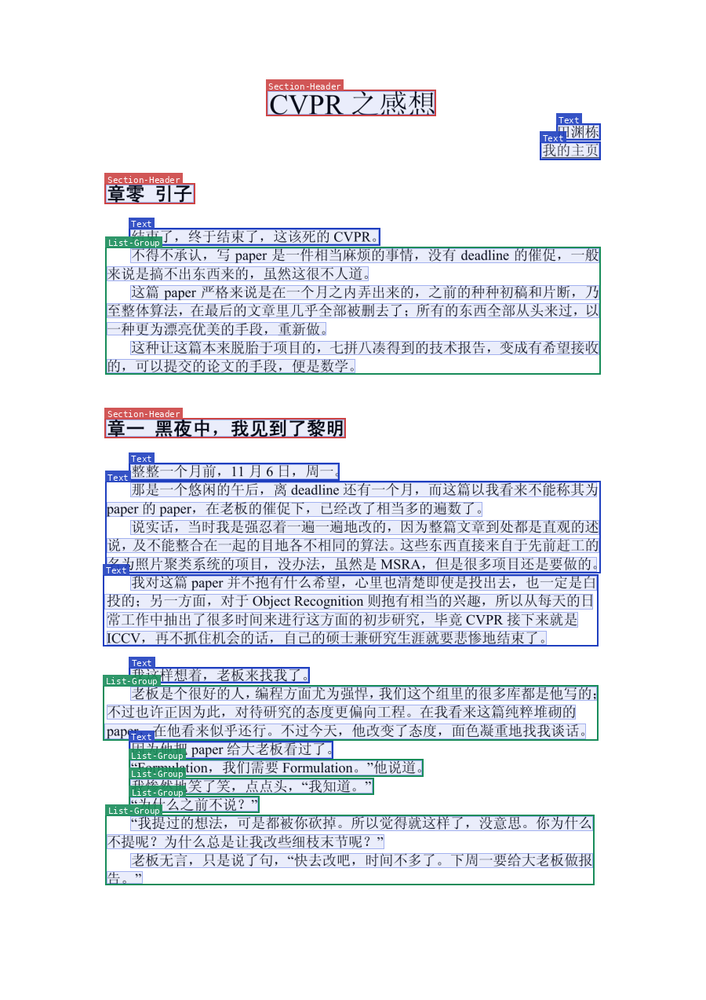

# Indra OCR examples

Real Indra OCR outputs on [OmniParseBench](https://github.com/datalab-to/omni_parse_bench) pages, with default settings (`--mode auto`, page headers and footers kept) unless a section says otherwise. The boxes are drawn from the JSON output: colored boxes are layout blocks with their label, faint blue boxes are lines. The outputs are not edited. The markdown excerpts are cut at "...". Some excerpts contain `##` lines: they are the page's own headings, inside a fenced block, not headings of this file. Back to the [README](README.md).

## Handwriting


A handwritten letter in cursive. Indra OCR finds every line and reads the body of the letter. The address lines at the top are harder, and come out with errors ("Sean Madam" for "Dear Madam"). Source: OCR. OmniParseBench page `synth_copies-images_svd6e177b7-p1`.

```markdown
...

The committee will meet again on Tuesday evening at seven.

Enclosed please find the receipt for the amount paid in full. Please forward the enclosed papers to the county clerk before Friday. We received forty-two crates of apples on the ninth of March, 1914. Kindly let me know whether the shipment arrived in good order. I remain, with great respect, your obedient servant.
...
```

## Korean


A scanned Korean letter with an English letterhead. Each line goes to the recognizer for its script. Source: OCR. OmniParseBench page `multiling_finepdfs-images_kor_Hang_07603024-p1`.

```markdown
...

코로나19 확산방지 대응을 위한 사목서신(8)

주님의 평화!

성령께서 우리를 부르시어 주님의 몸된 교회를 이루게 하시고, 거룩한 길로 이끌어주심을 감사하고 찬양합니다.

...
```

## Thai



A Thai academic calendar, read by OCR (`--mode ocr`; the PDF also has a text layer, which `--mode auto` would read instead). The table comes out as HTML. Source: OCR. OmniParseBench page `multiling_finepdfs-tha_Thai_22015278-p1`.

```markdown
## ปฏิทินการศึกษา ระดับประกาศนียบัตรวิชาชีพ ปีการศึกษา 2563 มหาวิทยาลัยเทคโนโลยีราชมงคลพระนคร

## (ฉบับแก้ไข)

<table>
...
<tr><td>3. วันสำเร็จการศึกษา</td><td colspan="2">วันประชุมสภามหาวิทยาลัย รอบที่อนุมัติประกาศนียบัตรวิชาชีพ</td><td></td><td></td></tr>
<tr><td>4. การลงทะเบียนและชำระเงิน</td><td></td><td></td><td></td><td>หมวด 2</td></tr>
...
```

## Tilted 30 degrees


An OmniParseBench page that we turned 30 degrees. Indra OCR finds the tilt (`skew: -30.0`), straightens the page, and reads it the same as the upright page. The boxes here are the line boxes turned back onto the tilted page. Source: OCR. OmniParseBench page `docparsing_images-images_a86e2831_images_legal_legal_provision_00051-p1`, turned 30 degrees.

```markdown
## EXECUTIVE OFFICE OF THE PRESIDENT OFFICE OF MANAGEMENT AND BUDGET WASHINGTON, D.C. 20503

December 18, 2019

## MEMORANDUM FOR USERS OF OMB CIRCULAR NO. A-11

FROM: Hee Jun Chief, Budget Concepts Branch SUBJECT: Revisions to OMB Circular No. A-11 dated June 28, 2019

We have updated the electronic version of OMB Circular No. A-11 to reflect some technical revisions.

The revised guidance:

• Adds a reference to Executive Order 13893, “Increasing Government Accountability for Administrative Actions by Reinvigorating Administrative PAYGO,” which was released in October 2019 and OMB Memorandum M-20-06 (section 31.3).
...
```

## Scanned upside down



A two-column annual report page from a digital PDF, upside down. Indra OCR turns the page upright (`rotation: 180`), then reads the columns in order and finds the headings. Source: PDF text layer. OmniParseBench page `rotation_skew-rse11a9ca2_rot180-p1`.

```markdown
...

In 2021, we took what we had learned from both programs to launch our latest ini ...

## Sustainable Finance

Another area where we’ve long been focused is sustainability. We have been a lea ...
```

## Table



A journal page from a digital PDF with two tables. Indra OCR reads the text layer and outputs each table as HTML, with its caption. Source: PDF text layer. OmniParseBench page `tables_derived-PMC2564913.1_doc-p4`.

```markdown
...

Table 1: Background data for the 75-year old study participants (n = 154).

<table>
<tr><th></th><th>Atrial fibrillation</th><th>No atrial fibriallation</th><th>Chi-square/df/p or t/d.f/p</th></tr>
<tr><td>Gender (male/female)</td><td>34 (31.8%)/12 (25.5%)</td><td>73 (68.2%)/35 (74.5%)</td><td>0.608/1/0.44</td></tr>
<tr><td>BMI (kg/m2)</td><td>25.3 ± 3.7</td><td>25.4 ± 3.2</td><td>-0.176/145/0.86</td></tr>
<tr><td>Waist (cm)</td><td>93.5 ± 11.7</td><td>91.6 ± 10.9</td><td>0.936/151/0.35</td></tr>
...
```

## Two columns and headings



A two-column journal page from a digital PDF. Indra OCR reads the text layer, orders the columns, and finds the section headings. Source: PDF text layer. OmniParseBench page `olmo_multi_column-0845863d27c84b14011e17a388821525e783_page_4_pg1-p1`.

```markdown
sand content and maturity of turbidite deposits. Such predictions require inform ...

## 2. Geological setting

The Precambrian Borborema Province in northeastern Brazil (Fig. 1) con
...
```

## Chinese



A typeset Chinese essay, read by OCR with the Chinese recognizer, with its headings. Source: OCR. OmniParseBench page `multiling_finepdfs-images_cmn_Hani_54743253-p1`.

```markdown
## CVPR 之感想

田渊栋

我的主页

## 章零 引子

结束了，终于结束了，这该死的 CVPR。

不得不承认，写 paper 是一件相当麻烦的事情，没有 deadline 的催促，一般来说是搞不出东西来的，虽然这很不人道。

## 章一 黑夜中，我见到了黎明

整整一个月前，11 月 6 日，周一。

...
```
