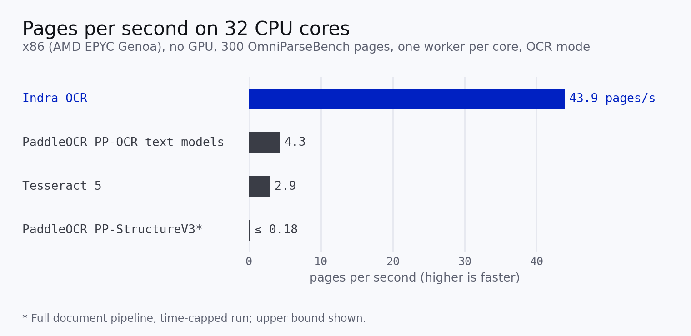
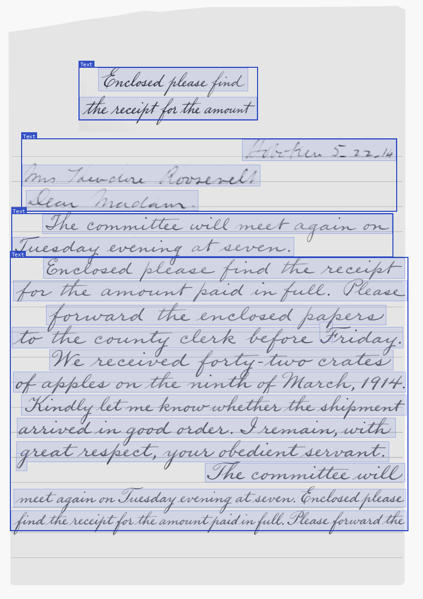
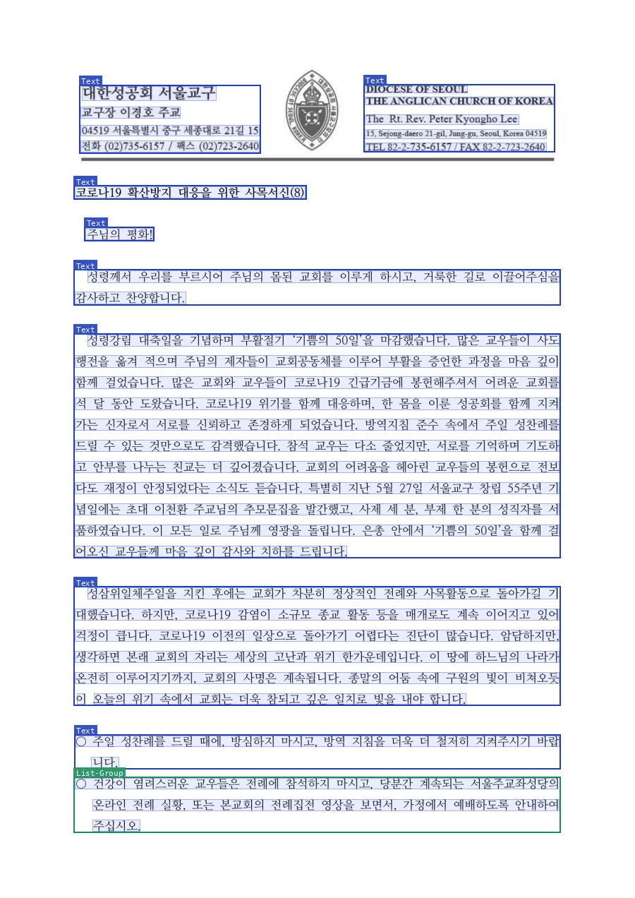
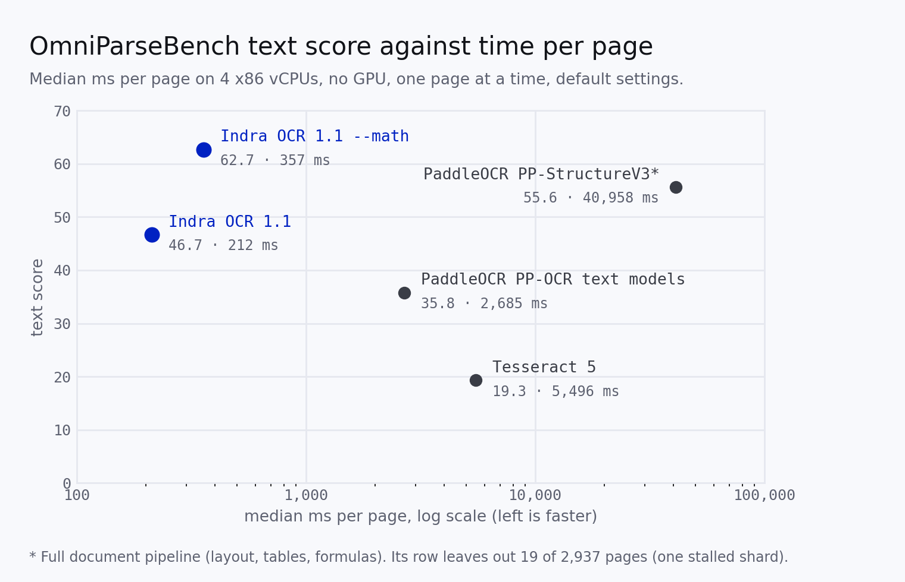

<p align="center">
  
</p>
<h1 align="center">Datalab</h1>
<p align="center">
  <strong>State of the Art models for Document Intelligence</strong>
</p>
<p align="center">
  <a href="https://opensource.org/licenses/Apache-2.0"></a>
  <a href="https://www.datalab.to/pricing"></a>
  <a href="https://discord.gg/KuZwXNGnfH"></a>
  <a href="https://huggingface.co/datalab-to/indra-ocr"></a>
</p>
<p align="center">
  <a href="https://www.datalab.to"></a>
  <a href="https://documentation.datalab.to"></a>
  <a href="https://www.datalab.to/playground"></a>
</p>

<hr/>

# Indra OCR

> **This repository is a fork.** It is [DylanMing/indra](https://github.com/DylanMing/indra), forked from [datalab-to/indra](https://github.com/datalab-to/indra), and it adds the desktop app: a native window, a tray icon, a Windows installer and a macOS `.dmg`, published on [this fork's releases](https://github.com/DylanMing/indra/releases). Those builds are unofficial and Datalab does not support them. The code is Apache-2.0; the model weights keep their [modified OpenRAIL-M licence](https://huggingface.co/datalab-to/indra-ocr/blob/main/LICENSE), and [THIRD-PARTY-NOTICES.md](THIRD-PARTY-NOTICES.md) lists what this fork changed.

Indra OCR is a 1M-parameter OCR model that runs on CPU. It turns PDFs and images into markdown, text, or JSON with boxes, and it reads handwriting, 80+ languages, and pages at any angle.

- **Accurate** - 66.7 on [OmniParseBench](https://github.com/datalab-to/omni_parse_bench) (71.4 with `--math`), ahead of PaddleOCR's full PP-StructureV3 pipeline (58.4). Its text score (46.7) is ahead of PaddleOCR's PP-OCR text models (35.8) and Tesseract (19.3).
- **Fast** - about 44 pages/s on 32 CPU cores, 15x Tesseract and 10x PaddleOCR's PP-OCR text models on the same machine type and pages, and about 210 ms per page on 4 cores ([benchmarks](#benchmarks))
- **80+ languages** - Latin-script languages, Russian and the Cyrillic languages, Greek, Chinese, Japanese, Korean, Arabic, Persian, Urdu, Hebrew, Hindi and the Indic languages, Thai, Khmer and more ([languages](#languages))
- **Handwriting** - handwritten pages and forms (25.2% on the OmniParseBench handwriting tests, see [limitations](#limitations))
- **Real-world scans** - sideways, upside down, tilted up to 45 degrees, light text on dark ground
- **Layout** - a box, a label and a reading order for every line and block (headings, lists, tables, captions, footnotes, page headers)
- **Digital PDFs** - reads the text layer in any script, and OCRs only what is missing
- **Small** - ONNX Runtime, no PyTorch, no GPU

Indra OCR is named for [Indra](https://en.wikipedia.org/wiki/Indra).



## Contents

- [Quickstart](#quickstart)
- [Examples](#examples)
- [Installation](#installation)
- [Usage](#usage) — [CLI](#cli), [From python](#from-python), [Viewer](#viewer), [Desktop app](#desktop-app)
- [Output](#output)
- [Languages](#languages)
- [Limitations](#limitations)
- [Math](#math)
- [Benchmarks](#benchmarks)
- [Credits](#credits), [Contributing](#contributing), [License](#license), [Commercial usage](#commercial-usage)

## Try Datalab's Managed Platform

Indra OCR is built for speed on CPUs. When you need the highest accuracy, on handwriting, math, complex tables and degraded scans, our managed platform runs [Chandra](https://github.com/datalab-to/chandra), our state of the art OCR model, with zero data retention by default, SOC 2 Type 2, and custom BAAs.

If you have high volume workloads, we offer a batch processing service that can handle 1B+ pages a day.

Get started with **$5 in free credits** - [sign up](https://www.datalab.to/?utm_source=gh-indra) - or try Chandra in our [public playground](https://www.datalab.to/playground?utm_source=gh-indra).

## Quickstart

```shell
pip install indra-ocr

indra-ocr paper.pdf                    # markdown to stdout
indra-ocr *.pdf --out results/         # one .md per input, all cores
indra-ocr scan.png --format json       # lines, boxes, layout blocks, confidences

indra-ocr-viewer                       # local web viewer on http://localhost:8765
```

The first run downloads the models (about 76 MB) from [Hugging Face](https://huggingface.co/datalab-to/indra-ocr). Prefer a window to a browser tab? `pip install "indra-ocr[desktop]"` and run `indra-ocr-desktop` — see [Desktop app](#desktop-app), which also explains the packaged `.exe`/`.dmg`.

## Examples

Real Indra OCR outputs on OmniParseBench pages. Colored boxes are layout blocks with their label, faint blue boxes are lines, drawn from the JSON output with no edits.

<table>
<tr>
<td width="50%"><br/><sub>A handwritten letter in cursive: Indra OCR finds every line and reads the body of the letter.</sub></td>
<td width="50%"><br/><sub>A scanned Korean letter: each line goes to the recognizer for its script.</sub></td>
</tr>
</table>

**[See more examples, with the markdown output for each →](https://github.com/datalab-to/indra/blob/main/EXAMPLES.md)**


# License

The code is [Apache 2.0](https://github.com/datalab-to/indra/blob/main/LICENSE). The model weights use a modified OpenRAIL-M license ([LICENSE](https://huggingface.co/datalab-to/indra-ocr/blob/main/LICENSE)).

# Commercial usage

This code is Apache 2.0, and our model weights use a modified OpenRAIL-M license (free for research, personal use, and startups under $20M funding/revenue, cannot be used competitively with our API). To remove the OpenRAIL license requirements, or for broader commercial licensing, visit our pricing page [here](https://www.datalab.to/pricing?utm_source=gh-indra).

# Installation

```shell
pip install indra-ocr
```

The default models are about 76 MB: 30 MB of networks and 46 MB of language models for unsure lines. The main recognizer, `rec.onnx` (Latin script), has about 1.25M parameters, and all default models together have 7.3M (the optional math models are extra).

For the latest code from GitHub instead: `pip install git+https://github.com/datalab-to/indra.git`. To let the viewer compare with Tesseract, install `pip install "indra-ocr[tesseract]"` and a Tesseract binary.

Python 3.10 or newer, tested on Linux (x86_64 and aarch64, Python 3.10 to 3.13), macOS (Apple silicon) and Windows 11 (x64). It installs ONNX Runtime, OpenCV and pypdfium2, and no PyTorch. The models download from Hugging Face on the first run and are cached. To use a local copy, set `INDRA_OCR_MODEL_DIR` or pass `--model-dir`.

# Usage

## CLI

```shell
indra-ocr paper.pdf                       # markdown to stdout
indra-ocr *.pdf --out results/            # one .md per input
indra-ocr scan.png --format json          # lines, boxes, layout blocks, confidences, timings
indra-ocr paper.pdf --format text         # plain text, one line per detected line
indra-ocr paper.pdf --mode ocr --timings  # ignore the text layer, OCR every page; timings on stderr
indra-ocr paper.pdf --keep-furniture      # keep page headers and footers in the markdown
indra-ocr *.pdf --out results/ --cores 8  # limit the cores (default: all usable cores)
indra-ocr paper.pdf --math                # write math as LaTeX (off by default; slower on math pages)
```

**CLI Options:**
- `--out DIR`: write one file per input (`.md`, `.txt` or `.jsonl`)
- `--format [md|text|json]`: output format (default: md)
- `--mode [auto|ocr|text]`: `auto` reads the text layer where it passes the checks and OCRs elsewhere (default). `ocr` never reads the text layer. `text` uses the text layer even when the checks fail
- `--no-image-ocr`: on text-layer pages, do not OCR text inside images
- `--cores N`: cores to use, one worker process each (default: all usable cores)
- `--dpi`: render resolution for PDFs (default: 200)
- `--max-pages N`: read at most N pages per file
- `--password`: password for encrypted PDFs
- `--keep-furniture`: keep page headers and footers in the markdown
- `--math`: write math as LaTeX (`$...$`); off by default, see [Math](#math)
- `--timings`: print per-page source and time to stderr
- `--model-dir`: folder with the models (default: download)

Exit codes: `0` when every input was read, `1` when one was not (a missing or locked file, a broken PDF, a bad password) or when the models are missing, with the reason on stderr. The CLI continues past files it cannot read, so the files that did work are still written to `--out`.

## From python

```python
import indra_ocr

conv = indra_ocr.load(threads=4)          # mode="auto" | "ocr" | "text"
for i, page in conv.convert("paper.pdf"):
    print(page.source, page.timings["total_ms"])
    print(page.markdown)                  # headings, lists, tables as HTML
    page.blocks                           # [{"label", "bbox", "text"}] in reading order
    page.lines                            # [Line(box, text, conf)] in reading order
```

An image file works the same way as a PDF (PNG, JPEG, TIFF, BMP, WebP; one page per TIFF frame). For an image already in memory, pass a grayscale `uint8` numpy array to `conv.ocr`:

```python
import cv2
import indra_ocr

conv = indra_ocr.load(threads=4)
for i, page in conv.convert("scan.png"):  # an image file
    print(page.text)

gray = cv2.cvtColor(cv2.imread("photo.jpg"), cv2.COLOR_BGR2GRAY)
page = conv.ocr(gray)                     # an image in memory
print(page.markdown)
```

Runnable examples: [`examples/ocr_image.py`](examples/ocr_image.py) (one image to markdown, text or JSON with boxes) and [`examples/quickstart.ipynb`](examples/quickstart.ipynb).

For many pages or files, `convert_many` runs one single-threaded worker process per core, one page per task, and returns results in input order:

```python
import indra_ocr

if __name__ == "__main__":                # worker processes re-import this file
    for path, result in indra_ocr.convert_many(["a.pdf", "b.pdf"], cores=None):
        if isinstance(result, indra_ocr.InputError):
            continue                      # unreadable or locked file
        for i, page in result:
            print(path, i, page.source)
```

Without the `if __name__ == "__main__":` guard (needed on macOS and Windows), `convert_many` warns and reads everything in one process.

`indra_ocr.load` takes `path` (model folder), `threads`, `dpi`, `mode`, `image_ocr`, `furniture` and `math`. `conv.convert` takes `max_pages` and `password`.

## Viewer

```shell
indra-ocr-viewer --port 8765              # opens http://localhost:8765
indra-ocr-viewer --no-browser             # print the URL, open nothing
indra-ocr-viewer --threads 4              # cores for reading a page (default: 4)
```

A local web viewer: drop in a PDF or an image, and each page shows its lines, layout blocks and reading order over the page, with the rendered markdown, the markdown source, the lines with their confidences, the JSON output and the time of each stage. The pipeline options (text layer or OCR, math, headers and footers, reading order, OCR of text inside images, dpi, page limit) are set in the page, and lines, blocks, block labels and reading order can each be shown or hidden. Files stay on your machine. Paste an image with `Ctrl+V` (`Cmd+V` on macOS) instead of dropping it: a screenshot on the clipboard is read like a dropped file. `--tesseract` lets the page compare with Tesseract (needs `pytesseract` and a Tesseract install; `--tesseract-lang` picks the languages, default `eng`). Over SSH, forward the port: `ssh -N -L 8765:localhost:8765 host` (with `--no-browser`, since the browser would open on the remote machine).

### Paste from the clipboard

`Ctrl+V` (`Cmd+V` on macOS) reads the image on the clipboard, through the same path as a dropped file, so a screenshot is OCR'd without saving it first. A copied PDF pastes too, where the browser hands the file over.

Some webviews (WebKitGTK, which pywebview uses on Linux) do not pass clipboard files to the page. For those the viewer has a **Paste from clipboard** button: it asks the local server, which reads the clipboard of the machine the app runs on (`indra_ocr/clipboard.py`: Pillow's `ImageGrab` on Windows and macOS, `wl-paste` or `xclip` on Linux).

## Desktop app

```shell
pip install "indra-ocr[desktop]"          # pywebview, Pillow, pystray
indra-ocr-desktop                         # a window, no browser tab
indra-ocr-desktop report.pdf              # ... with that file opened and read
indra-ocr-desktop --tray                  # keep running in the tray when closed
indra-ocr-desktop --hotkey "ctrl+alt+o"   # show the window from anywhere
indra-ocr-desktop --port 8899             # a fixed port (0, the default: any free one)
indra-ocr-desktop --width 1400 --height 950
```

The window is the viewer in the system webview (WebView2 on Windows, WKWebView on macOS, WebKitGTK on Linux), served from a localhost port the app picks unless you pass `--port`. `--threads` (default 4) is how many cores read one page; the size is `1280x920` unless `--width`/`--height` say otherwise. Models are looked for in this order: `--model-dir`, `INDRA_OCR_MODEL_DIR`, a `models/` folder beside the app, then a Hugging Face download.

With a tray icon (the default when `pystray` is installed; `--no-tray` for off) closing the window hides it and the app keeps running: **Open** in the tray menu brings it back, **Quit** ends it. A global hotkey (`--hotkey`, default `ctrl+alt+o`, Windows) shows the window from any program; `--hotkey ""` disables it. `INDRA_OCR_DEBUG_PORT=9222` opens a DevTools port on the local page, to see what the window actually renders.

On start the app checks that the models are where it expects and, on Windows, that the WebView2 runtime is installed: a broken bundle says so in a dialog instead of failing on the first click. What it found is written to `%LOCALAPPDATA%\IndraOCR\state.json` (version, first and last run, problems), which is all the app writes about itself.

To package it as a self-contained app (the models go inside, so it runs with no network and no Python install):

```shell
pip install "indra-ocr[desktop,build]"    # adds PyInstaller
python packaging/build.py                 # -> dist/IndraOCR/ (about 350 MB; 730 MB on Linux, with GTK)
python packaging/build.py --console 0     # release build: no console window
python packaging/build.py --models packaging/models   # reuse an already staged folder
python packaging/build.py --console 0 --installer     # ... and a Windows setup .exe
python packaging/build.py --skip-selftest             # skip the headless check (faster, less safe)
```

The app is `dist/IndraOCR/IndraOCR` (`IndraOCR.exe` on Windows; on macOS the spec also builds `dist/IndraOCR.app`, the bundle a Finder user launches): that folder is what you ship. The build stages the models from the local Hugging Face cache (or `--models DIR`), runs PyInstaller with `packaging/indra_ocr.spec`, and then runs `dist/IndraOCR/IndraOCR --selftest`, which starts the server, uploads a generated page and reads it back over HTTP: a bundle that cannot OCR fails the build instead of failing on a user's machine. The exe carries the icon (`packaging/make_icon.py` draws `packaging/indra_ocr.ico` and the macOS `packaging/indra_ocr.icns`) and a VERSIONINFO resource, so Explorer and Add/Remove Programs show a name and a version. PyInstaller does not cross-compile, so each platform is built on its own OS (`.github/workflows/desktop.yml` does the three); the spec bundles pywebview's .NET assemblies on Windows, where the target machine needs the WebView2 runtime — Windows 11 ships it, Windows 10 gets it with Edge, and when it is missing the app says so in a dialog rather than showing an empty window.

On Linux the window is WebKitGTK. The bundle carries GTK 3 (PyInstaller picks it up from the build machine's `dist-packages`, which `build.py` puts on the analysis path), but not WebKit2GTK — a browser engine with helper processes of its own, not something to fold into another app — so the machine that runs it needs `libwebkit2gtk-4.1-0` (`libwebkit2gtk-4.0-37` on 22.04), as any desktop distribution with GNOME or XFCE already has. The app extends `GI_TYPELIB_PATH` to the system's typelib folders for exactly that, because PyInstaller's GI hook otherwise points it at the bundled folder alone. CI checks it: on Linux it runs `dist/IndraOCR/IndraOCR --windowtest` under `xvfb`, which opens the real window and closes it, since the headless `--selftest` cannot see a missing GTK or WebKit2.

### Windows installer

`--installer` runs Inno Setup (`packaging/indra_ocr.iss`) after the build and writes `dist/IndraOCR-<version>-setup.exe`: about 160 MB, lzma2, English and Simplified Chinese. It installs per user (no admin prompt) into `%LOCALAPPDATA%\Programs\IndraOCR`, with a Start menu shortcut, an uninstall entry and, if the box is ticked, a `.pdf` association that starts the app on the double-clicked file. Needs Inno Setup 6 (`winget install JRSoftware.InnoSetup`); `build.py` finds `ISCC.exe` on the path or in the usual install folders.

```shell
python packaging/build.py --console 0 --installer
```

It writes the SHA256 beside the setup (`IndraOCR-<version>-setup.exe.sha256`, the `sha256sum` format) and prints it, because the installer is not code signed: see [Installing on Windows](#installing-on-windows) for what a user sees and how to check the download. To sign it instead, add an Authenticode certificate on the build machine (and a timestamp, so the signature outlives the certificate):

```shell
signtool sign /fd sha256 /tr http://timestamp.digicert.com /td sha256 /a dist\IndraOCR-<version>-setup.exe
signtool sign /fd sha256 /tr http://timestamp.digicert.com /td sha256 /a dist\IndraOCR\IndraOCR.exe
```

macOS (`codesign --deep --options runtime --sign "Developer ID Application: ..."` plus `xcrun notarytool submit`) and Linux (AppImage, and `.deb` with `dpkg-deb`) are the same shape: build on the platform, sign what the platform checks, ship the result. `.github/workflows/desktop.yml` builds and tests all three; the signing steps are commented out there, where the certificates would be secrets.

### Installing on Windows

Download `IndraOCR-<version>-setup.exe` from [this fork's releases](https://github.com/DylanMing/indra/releases) (the `.sha256` is beside it in each release), then double-click it. It installs per user, so there is no admin prompt; the wizard is in English and Simplified Chinese, and shows the licences before it installs.

These builds are unofficial: they come from a fork, not from Datalab, and the model weights keep their own licence (see [THIRD-PARTY-NOTICES.md](THIRD-PARTY-NOTICES.md)).

**The installer is not code signed.** There is no Authenticode certificate behind it, so Windows cannot show who published it, and two prompts reflect that:

- SmartScreen: "Windows 已保护你的电脑 / Microsoft Defender SmartScreen prevented an unrecognized app from starting". Click **更多信息 / More info**, then **仍要运行 / Run anyway**.
- The elevation prompt (only if you chose an all-users install) says **未知发布者 / Unknown publisher**.
- macOS and Linux ask for nothing on this front; a macOS build would need its own signing and notarisation.

Nothing is wrong with the file: it is the same build that [`.github/workflows/desktop.yml`](.github/workflows/desktop.yml) produced. To check that what you downloaded is what was built, compare its SHA256 with the `.sha256` published next to it:

```powershell
# PowerShell: prints the hash, compare with IndraOCR-<version>-setup.exe.sha256
Get-FileHash .\IndraOCR-1.1.4-setup.exe -Algorithm SHA256

# or, no PowerShell:
certutil -hashfile IndraOCR-1.1.4-setup.exe SHA256

# or, with the .sha256 file in the same folder (prints True when they match):
(Get-Content .\IndraOCR-1.1.4-setup.exe.sha256).Split(' ')[0] -eq (Get-FileHash .\IndraOCR-1.1.4-setup.exe -Algorithm SHA256).Hash.ToLower()
```

`sigcheck -h IndraOCR-1.1.4-setup.exe` from [Sysinternals](https://learn.microsoft.com/sysinternals/downloads/sigcheck) shows the same hash and "Unsigned".

Inside one organisation, a build can be signed with a certificate the admins already trust, and then there is no prompt at all: `New-SelfSignedCertificate -Type CodeSigningCert` on a machine the domain trusts, or a certificate from the organisation's own CA, pushed to the other machines once (Group Policy → Trusted Root / Trusted Publishers), then signed with the same `signtool` line. A self-signed certificate that nobody trusts changes nothing for a stranger, which is why the public build ships a hash instead.

### macOS app and .dmg

On macOS the spec builds a real bundle next to the one-folder build — `dist/IndraOCR.app`, with `Info.plist` (name, version, `LSMinimumSystemVersion` 11.0, Retina) and the icon from `packaging/indra_ocr.icns` that `make_icon.py` draws — and `--dmg` packs it:

```shell
python packaging/build.py --console 0 --dmg
```

That writes `dist/IndraOCR-<version>.dmg` (`UDZO`, HFS+; the 466 MB bundle compresses to about 200 MB, against 160 MB for the Windows setup) holding `IndraOCR.app` and an `/Applications` link, so installing is a drag, and `IndraOCR-<version>.dmg.sha256` beside it. `hdiutil verify` runs on the result: an image that mounts empty fails the build. It has to be built on a Mac (PyInstaller does not cross-compile); `.github/workflows/desktop.yml` does it on `macos-latest` and uploads only the `.dmg`, because an uploaded `.app` loses its executable bit.

The app is not signed or notarised either, so Gatekeeper says "“Indra OCR” cannot be opened because Apple cannot check it for malicious software". To open it once: right-click the app → **Open** → **Open**. Or remove the quarantine flag the download carries:

```shell
xattr -dr com.apple.quarantine /Applications/IndraOCR.app
```

Check the download the same way as on Windows: `shasum -a 256 IndraOCR-1.1.4.dmg` against the `.sha256` file. To sign and notarise it (needs an Apple Developer account, a "Developer ID Application" certificate in the keychain, and an app-specific password or API key):

```shell
codesign --deep --force --options runtime --timestamp \
  --sign "Developer ID Application: Your Name (TEAMID)" dist/IndraOCR.app
ditto -c -k --keepParent dist/IndraOCR.app IndraOCR.zip     # notarytool wants a zip
xcrun notarytool submit IndraOCR.zip --apple-id you@example.com \
  --team-id TEAMID --password "$APP_PASSWORD" --wait
xcrun stapler staple dist/IndraOCR.app
python packaging/build.py --dmg-only      # pack the signed, stapled app
```

Sign before packing: the `.dmg` carries the bundle as it was, so `--dmg-only` packs the existing `dist/IndraOCR.app` instead of rebuilding over the signature.

### Upgrading and uninstalling

**Windows**: run the new `IndraOCR-<version>-setup.exe` over the installed copy. It carries the same application id, so it upgrades in place — no uninstall first, and the settings and `state.json` stay. To remove it, use **Settings → Apps → Indra OCR** (or `%LOCALAPPDATA%\Programs\IndraOCR\unins000.exe`): the program folder, both shortcuts, the uninstall entry, the `.pdf` association and `%LOCALAPPDATA%\IndraOCR` go; the PDFs you opened stay where they were.

**macOS**: drag `IndraOCR.app` from the image into `/Applications`; a newer `.dmg` replaces it. Uninstall is dragging it to the Trash, plus `rm -rf ~/.local/state/IndraOCR` for the state file.

**Linux**: the folder is the install, so delete it; the state file is `~/.local/state/IndraOCR/state.json` (`$XDG_STATE_HOME` when set).

**pip**: `pip install -U indra-ocr` (`-U "indra-ocr[desktop]"` for the window). The models live in the Hugging Face cache, so an upgrade does not download them again.

### Troubleshooting

The app keeps one file about itself: `%LOCALAPPDATA%\IndraOCR\state.json` on Windows, `~/.local/state/IndraOCR/state.json` elsewhere, with the version, the first and last run, the model folder it used and whatever it found wrong. Start there.

- **The window is empty or the app does not appear.** On Windows the WebView2 runtime is missing: install the [Evergreen runtime](https://developer.microsoft.com/microsoft-edge/webview2/), then start the app again — it says so in a dialog when that check fails. On Linux the GTK half is bundled but WebKit2GTK is not: `sudo apt install libwebkit2gtk-4.1-0` (`4.0` on 22.04) — and if you built the bundle yourself, `python3-gi gir1.2-gtk-3.0` on the build machine as well. `dist/IndraOCR/IndraOCR --windowtest` opens the real window and closes it, which is the quickest way to see whether a bundle can show anything at all. To see what the window actually renders, `INDRA_OCR_DEBUG_PORT=9222 indra-ocr-desktop`, then open `http://127.0.0.1:9222/json/list`.
- **`cannot listen on 127.0.0.1:PORT: Address already in use`.** Another copy is running, or something else took the port you pinned with `--port`. Leave `--port` off (or pass `--port 0`) and the app picks a free one. A windowed build has no console, so this now arrives as a dialog instead of vanishing.
- **A dialog says the models are missing.** It lists what it looked for. Point `--model-dir` or `INDRA_OCR_MODEL_DIR` at a folder with `det.onnx`, `rec.onnx`, `order.onnx` and `meta.json`, or copy a `models/` folder beside the executable — that is how an offline install is made.
- **The first page is slow.** The models load on first use; after that a page takes tens of milliseconds (`--selftest` reports the machine's speed). `--cores`/`--threads` bound how many cores one page may use.
- **A PDF opens elsewhere but not here.** If it is encrypted, pass `--password`; if it has no text layer, that is fine — it is OCR'd. A file with junk before the `%PDF` header is recovered rather than rejected.
- **No tray icon, or the hotkey does nothing.** Both need `pystray` (`pip install "indra-ocr[desktop]"`). The hotkey is Windows-only and needs a combination nothing else holds: if another program took it, the app says which.
- **The installer warns about an unknown publisher.** Expected: it is not code signed, and [Installing on Windows](#installing-on-windows) has the hash check and the exact clicks.

## Output

Every page is a `Page` with:

- `markdown`: headings (`##`), paragraphs, lists, and tables as HTML. Page headers and footers are left out unless `furniture=True` / `--keep-furniture`
- `text`: one line per detected line, in reading order
- `lines`: `Line(box, text, conf)`, box is `x0, y0, x1, y1` in image pixels
- `blocks`: layout blocks in reading order, `{"label", "bbox", "text"}`
- `source`: `text` (PDF text layer), `ocr`, `hybrid` (text layer + OCR of text inside images) or `error`
- `rotation`, `skew`: the quarter or half turn applied (degrees), and the small tilt straightened
- `vertical`: the page is set in vertical columns (Chinese, Japanese): it was read turned a quarter turn, and its boxes are on the page as it is
- `timings`: per-step milliseconds, with `total_ms`
- `note`: why the page took its path

Block labels: `Text`, `Section-Header`, `Page-Header`, `Page-Footer`, `List-Group`, `Table`, `Caption`, `Footnote`, `Table-Of-Contents`, `Form`. `--format json` writes one JSON object per page with all of these fields.

# Languages

**OCR (scans and images):** we measured 95 languages on held-out printed pages: 83 read at character F1 0.90 or higher, and 67 at 0.95 or higher. Four recognizers, and a line classifier that sends each line to one of them:

- `rec.onnx`: Latin (about 50 languages, with the letters of Hausa, Fula, Akan, Azerbaijani and Uzbek and the tone marks of Vietnamese and Yoruba), Cyrillic, Greek, and handwriting in Latin script.
- `rec_cjk.onnx`: Chinese (simplified and traditional), Japanese (kana and kanji), Korean.
- `rec_rtl.onnx`: Arabic, Persian, Urdu, Pashto, Kurdish, Hebrew. Lines come out in logical order, and a right-to-left page reads its right column first.
- `rec_world.onnx`: Devanagari (Hindi, Marathi, Nepali), Bengali, Tamil, Telugu, Kannada, Malayalam, Gujarati, Gurmukhi, Odia, Thai, Lao, Khmer, Myanmar, Sinhala, Georgian, Armenian, Ethiopic.

When the classifier is not sure of a line, the main recognizer reads it too, and the more confident reading wins.

OmniParseBench, per script (tests in parentheses):

| Script | Score | Script | Score |
|---|---|---|---|
| Latin (9,406) | 61.6 | Thai (39) | 87.2 |
| Chinese (136) | 64.0 | Lao (52) | 96.2 |
| Korean (24) | 79.2 | Khmer (34) | 70.6 |
| Japanese kana (19) | 57.9 | Tamil (25) | 84.0 |
| Devanagari (23) | 69.6 | Telugu (33) | 87.9 |
| Bengali (40) | 77.5 | Kannada (48) | 93.8 |
| Arabic (13) | 69.2 | Malayalam (40) | 65.0 |
| Hebrew (30) | 80.0 | Gujarati (15) | 80.0 |
| Georgian (14) | 100 | Gurmukhi (31) | 64.5 |
| Armenian (60) | 100 | Ethiopic (43) | 100 |

Most scripts have few tests, so one test moves a score by 2 to 8 points. On [OmniDocBench](https://github.com/opendatalab/OmniDocBench) v1.5 (OCR only, 1,651 pages, our run without the formula metric), the text edit distance is 0.114 on English pages and 0.237 on simplified Chinese pages (lower is better), and table TEDS is 0.47.

**Vertical text.** Chinese and Japanese pages set in vertical columns are read turned a quarter turn, so each column is a line for the CJK recognizer. Scans are found by the orientation model, digital PDFs by their text layer. `page.vertical` is set, and boxes are on the page as it is.

**Text layer (digital PDFs): any script.** We checked text mode on 1,125 pages from 75 language families. On pages whose layer passes the checks, Indra OCR keeps at least 98% of the layer's characters in every family, including Arabic, Hebrew, Persian, Urdu, Thai, Khmer, Lao, Myanmar, Georgian, Armenian, Ethiopic, the Indic scripts, Chinese, Japanese and Korean. Right-to-left lines keep their right-to-left order.

# Limitations

Indra OCR is built for speed on clean print. It is not the right tool for:

- **Complex tables.** Tables with merged or spanning cells, cell text that wraps over several lines, nested headers, or no ruling lines can come out with cells in the wrong rows or columns. Simple grid tables read well.
- **Handwriting.** Handwritten pages read, but not well: 25.2% on the OmniParseBench handwriting tests, and about a third of the words on held-out handwritten pages. Cursive and faint pencil read worst.
- **Scripts outside the OCR list.** Syriac, Tibetan, Mongolian, Santali, Meitei and other scripts not listed under [Languages](#languages) work only through a digital PDF's text layer. Khmer and Malayalam OCR are fair (65 to 71 on OmniParseBench). Written Cantonese characters (嘅 咗 冇) are not in the Chinese recognizer.
- **Latin languages with many diacritics.** Some of them (Kurmanji, Czech, Lithuanian, Icelandic, Turkish, Slovak) read less well: the recognizer sometimes writes a close diacritic instead of the right one (ñ for ň, ú for ů, é for ė). English, French, German and Spanish are not affected.
- **Degraded scans.** Old, faded or low-resolution scans read poorly (29.5% on the OmniParseBench degraded-scan tests).

Also:

- Math comes out as plain text unless `--math` is on (see [Math](#math)).
- Vertical pages read their columns right to left and their tiers top to bottom; a newspaper whose articles wind across tiers can come out in the wrong article order. Vertical scans read less well than horizontal ones.
- Very wide, banner-shaped pages read poorly.
- Labels inside engineering drawings often come out as small tables.
- Pages above 100 megapixels at 200 dpi render at a lower dpi, so small text on them can be lost.

For these documents, [Chandra on Datalab](https://www.datalab.to/?utm_source=gh-indra) is the accurate option.

# Math

Math is off by default. With `--math` (or `indra_ocr.load(math=True)`), a small classifier finds the lines that hold math, and a second recognizer reads them as text with inline LaTeX (`we have $x _ { i } \leq 1$`).

On OmniParseBench (all 2,937 pages, default settings otherwise):

| | headline | text | tables | layout | math tests |
|---|---|---|---|---|---|
| Indra OCR | 66.7 | 46.7 | 61.1 | 92.2 | 14.0 |
| Indra OCR `--math` | **71.4** | **62.7** | 59.6 | 92.0 | **55.8** |
| PaddleOCR PP-StructureV3 | 58.4 | 55.6 | 47.8 | 71.7 | – |

- With `--math`, Indra OCR is ahead of PaddleOCR's PP-StructureV3 on the headline, text, tables and layout. Without it, PP-StructureV3 leads on text.
- Tables lose 1.5 points: numbers in some table cells are read as math.
- `--math` is slower. On x86, one page at a time on 4 vCPUs in auto mode, the median page takes 357 ms with `--math` and 212 ms without. With one single-threaded worker per core, throughput is about 30% lower on 4 cores and 38% lower on 32 (measured in one container on 300 OmniParseBench pages).

The math models download only when `--math` is on.

# Benchmarks

## OmniParseBench

[OmniParseBench](https://github.com/datalab-to/omni_parse_bench) has 16,288 pass/fail tests on 2,937 pages. The headline is the mean of the text, tables and layout families. All runs: x86, 4 vCPUs per engine, one page at a time, every engine on the same pages with the same scorer and its default settings.



| engine | headline | text | tables | layout | median ms / page |
|---|---|---|---|---|---|
| Indra OCR (auto: text layer + OCR) | 66.7 | 46.7 | **61.1** | **92.2** | **212** |
| Indra OCR (OCR only)‡ | 61.2 | 40.7 | 52.7 | 90.3 | 344 |
| Indra OCR `--math` (auto) | **71.4** | **62.7** | 59.6 | 92.0 | 357 |
| PaddleOCR PP-OCRv6 small, text models only (RapidOCR) | – | 35.8 | 0.0 | – | 2,685 |
| PaddleOCR PP-StructureV3 (2,918 pages\*) | 58.4 | 55.6 | 47.8 | 71.7 | 40,958 |
| Tesseract 5 (our run, Latin model) | – | 19.3 | 0.0 | – | 5,496 |

- Indra OCR's accuracy comes from the benchmark's own Indra OCR adapter and scorer (omni-parse-bench 1.0.0rc1, dataset revision 961c0f89), as on the OmniParseBench leaderboard. ‡The OCR-only row and the other engines come from our runs of the same pages and scorer. The median ms column comes from the x86 run below.
- The PP-OCR text models and Tesseract output lines, not tables or layout blocks, so their table scores are 0 and their layout family is not scored.
- PP-StructureV3 is PaddleOCR's full document pipeline (layout, tables, formulas). Without `--math`, it reads text better than Indra OCR (55.6 vs 46.7). With `--math`, Indra OCR is ahead on text too (62.7). It takes about 190 times as long per page as Indra OCR's default mode. \*One of its 150 shards stalled for 6 hours on its first page, so its row leaves out 19 pages.
- Faster settings exist, but we did not score their accuracy. Tesseract with the `eng` model and 1 thread takes 3.4 s a page (6.1 s as run). PP-StructureV3 without formula, seal and chart recognition, unwarping and orientation, and with its mobile OCR models, takes 10.5 s a page. Indra OCR is still 16-50x faster per page.
- The OmniParseBench leaderboard's own Tesseract run scores 17.6 on text.
- Median latency varies by about 15% between runs of the same code, so compare engines within one run. The Indra OCR rows come from one run. The other engines ran earlier, on the same container type and pages.

**Chinese** (136 OmniParseBench Chinese tests): Indra OCR 64.0, PaddleOCR PP-OCRv5 mobile Chinese text models 65.4, PP-StructureV3 68.4.

## olmOCR-bench

Born-digital splits and old scans, our harness, 200 dpi:

| split | Indra OCR | Tesseract 4 |
|---|---|---|
| headers_footers | 91.2 | 35.5 |
| multi_column | 70.0 | 70.4 |
| long_tiny_text | 67.9 | 64.0 |
| table_tests | 60.5 | 1.0 |
| old_scans | 20.0 | 18.4 |

## Throughput

The CLI and `convert_many` run one single-threaded worker process per usable core, one page per task, so a single long PDF also uses every core. `--cores` limits it.

Pages per second on x86 (AMD EPYC 9004 Genoa, 34 cores, no GPU), on the same 300 OmniParseBench pages, with one single-threaded worker per core, OCR mode and default settings. The other engines ran once on the same machine type and pages.

| engine | 4 cores | 8 cores | 16 cores | 32 cores |
|---|---|---|---|---|
| Indra OCR | **6.2** | **11.9** | **23.7** | **43.9** |
| PaddleOCR PP-OCRv6 small, text models only (RapidOCR) | 0.65 | 1.24 | 2.42 | 4.28 |
| Tesseract 5 | 0.78 | 1.37 | 2.27 | 2.92 |
| PaddleOCR PP-StructureV3\* | ≤ 0.022 | ≤ 0.044 | ≤ 0.089 | ≤ 0.18 |

At 32 cores, Indra OCR is 10x PaddleOCR's PP-OCR text models and 15x Tesseract. \*PP-StructureV3 ran a time-capped subset of other OmniParseBench pages in an earlier run, so its numbers are upper bounds.

Throughput depends on the CPU: on other x86 container types we measured 25 to 51 pages per second at 32 cores.

Model loading and one warm-up page per worker are not timed.

## Reproducing

```shell
git clone https://github.com/datalab-to/indra.git && cd indra
pip install indra-ocr 'omni-parse-bench[benchmark]'
python bench/opb_indra.py --out runs/opb_auto --mode auto --procs 8
```

Each page runs in a single-threaded worker process, page headers and footers kept. `--mode ocr` gives the OCR-only row, `--math` the `--math` row, `--suites` scores only the listed suites, `--limit N` scores the first N pages, and `--models` points at a local model folder. The run writes `summary.json` (the benchmark's own summary, plus median and p90 ms per page) and `pages.jsonl` (per page: time, source, tests passed). The tables above come from our x86 harness, which gives each page 4 threads. This script gives each page one thread, so its times differ, and its scores can differ by a few tenths of a point.

# Contributing

Bug reports and patches are welcome. [CONTRIBUTING.md](CONTRIBUTING.md) has the development setup, a map of the modules, how to build the desktop app on your own machine, and what a release does:

```shell
pip install -e ".[test]" && pytest -q     # no models, no network, about ten seconds
```

# Credits

Thank you to the following open source projects:

- [ONNX Runtime](https://github.com/microsoft/onnxruntime)
- [pypdfium2](https://github.com/pypdfium2-team/pypdfium2)
- [OpenCV](https://github.com/opencv/opencv)
- [Hugging Face Hub](https://github.com/huggingface/huggingface_hub)
